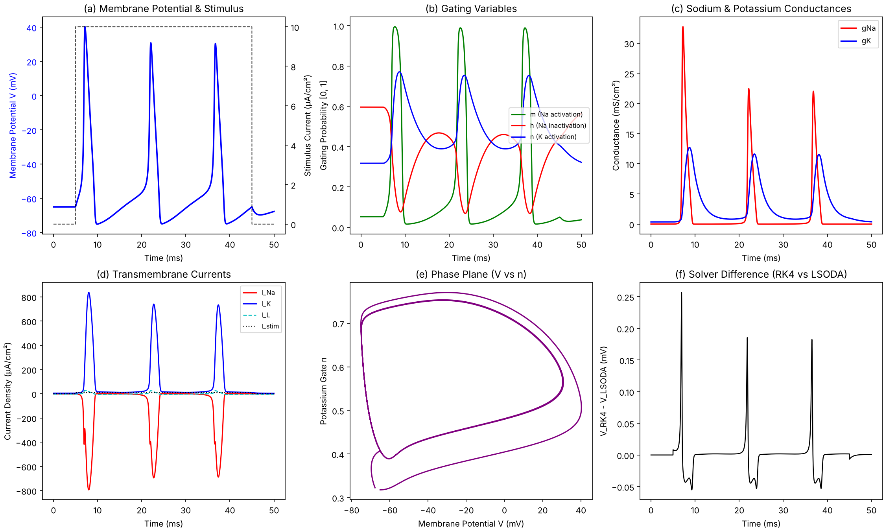
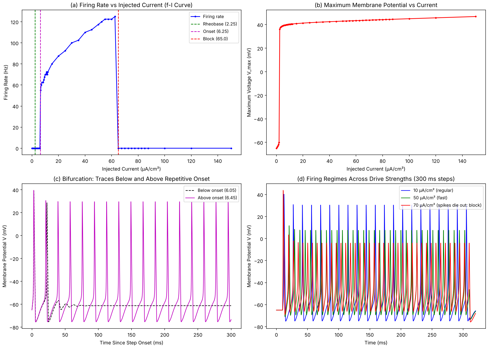
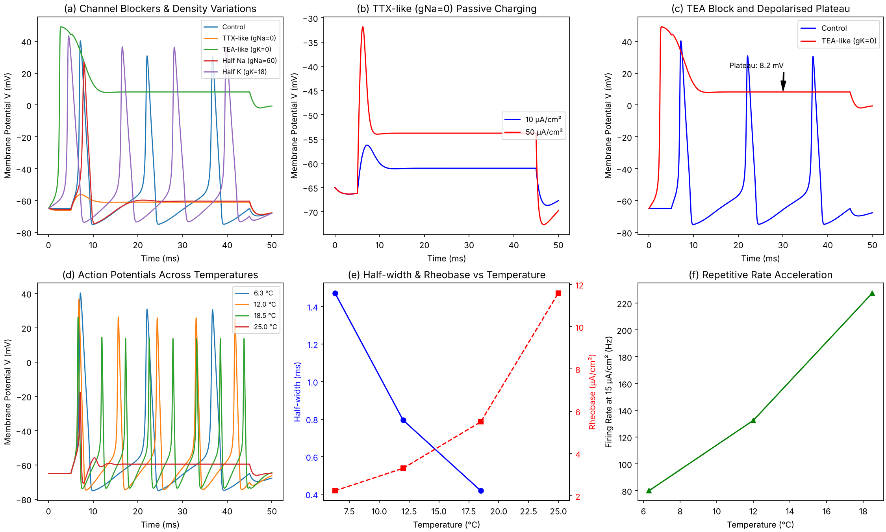
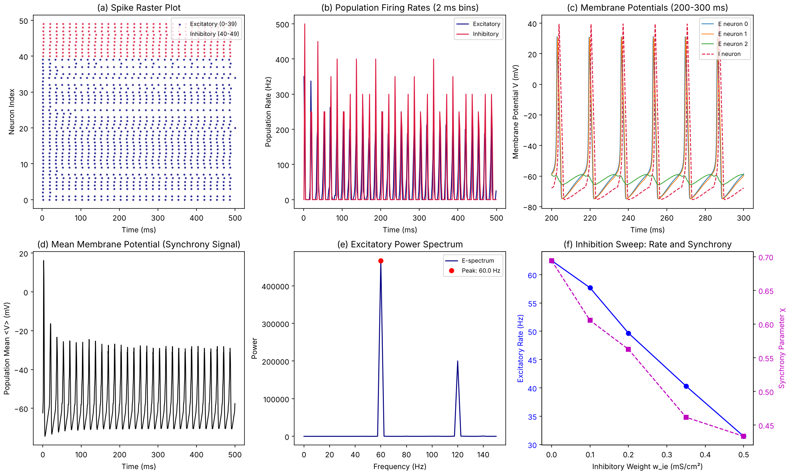

# hh-spiking-lab

Author: Ameya S. Deshpande

A from-scratch Python implementation of the 1952 Hodgkin–Huxley squid-axon model, with analysis
tools, four numerical experiments, a 50-neuron excitatory–inhibitory network built from the same
cells, unit tests and an interactive Streamlit demo. The single-cell model has one compartment
(no spatial propagation).

## Implementation & Engineering Notes

This project is a from-scratch Python implementation of the 1952 Hodgkin–Huxley squid-axon model. Generative AI tools were used for drafting specifications and boilerplate acceleration; all electrophysiological rate equations, removable-singularity handling, solver cross-checks (LSODA vs. RK4), and network synchrony analyses were independently verified, debugged, and validated against canonical literature.

## What it does

The experiments answer six questions:

1. What does one action potential look like: peak, width, afterhyperpolarisation, gating
   variables, sodium and potassium conductances?
2. How does the neuron go from silence to firing? Rheobase versus onset of repetitive firing
   (the jump that marks class 2 excitability).
3. What happens when the drive is too strong (depolarisation block)?
4. What do TTX-like (sodium channels off) and TEA-like (potassium channels off) blockers do, and
   what happens when channel densities are halved?
5. How does temperature change spike width, height and threshold, including heat block?
6. In a small network, how does inhibition change firing rate, synchrony and rhythm?

## Quick start

```bash
pip install -r requirements.txt

python experiments/exp1_action_potential.py      # about 10 s
python experiments/exp2_fi_curve.py              # about 1-2 min
python experiments/exp3_blockers_temperature.py  # about 1 min
python experiments/exp4_ei_network.py            # about 1-2 min

streamlit run app.py                             # interactive demo

pytest -m "not slow"                             # fast tests, about 1 min
pytest                                           # all tests, a few minutes
```

Each experiment writes a PNG and a `*_summary.json` into `results/` (use `--outdir` to change
this and `--show` to open the figure).

## Results

All values below come from the committed `results/*_summary.json` files (single run, default
settings, Python 3.13, NumPy 2.5, SciPy 1.18). Currents are in µA/cm².

| Experiment | Quantity | Result | Source (JSON key) |
|---|---|---|---|
| 1 | Peak voltage (10 µA/cm² step) | 40.3 mV | `peak_mV` |
| 1 | First-spike half-width (6.3 °C) | 1.47 ms | `half_width_ms` |
| 1 | Afterhyperpolarisation | −75.1 mV | `ahp_mV` |
| 1 | Peak gNa / peak gK | 32.7 / 12.7 mS/cm² | `peak_gNa_mS_cm2`, `peak_gK_mS_cm2` |
| 1 | LSODA vs RK4, first spike time | 0.0008 ms apart | `rk4_vs_lsoda_first_crossing_diff_ms` |
| 2 | Rheobase (200 ms step) | 2.25 | `rheobase_uA_cm2` |
| 2 | Onset of repetitive firing (≥10 spikes in 1 s) | 6.25 (2.8 × rheobase) | `repetitive_onset_uA_cm2` |
| 2 | Lowest non-zero firing rate on the grid | 55 Hz | `lowest_nonzero_rate_hz` |
| 2 | Rate at 10 / 50 | 70 / 117.5 Hz | `rate_hz_at_10`, `rate_hz_at_50` |
| 2 | Depolarisation block onset (first grid current with rate below half the maximum) | 65 | `block_onset_uA_cm2` |
| 3 | TTX-like (gNa = 0), peak at 10 / 50 | −56.3 / −31.9 mV, no spike | `ttx_peak_mV_I10`, `ttx_peak_mV_I50` |
| 3 | TEA-like (gK = 0), V at 30 ms | 8.2 mV (one spike, then a plateau) | `tea_V_at_30ms_mV` |
| 3 | Half gNa / half gK, spikes in 40 ms at 10 | 1 / 4 (control: 3) | `half_gNa_spikes`, `half_gK_spikes` |
| 3 | Half-width at 6.3 / 12 / 18.5 °C | 1.47 / 0.79 / 0.42 ms | `temperature[].half_width_ms` |
| 3 | Spike at 25 °C, 10 µA/cm² | none (peak −17.7 mV, heat block) | `temperature[].peak_mV` |
| 3 | Rheobase at 6.3 / 12 / 18.5 / 25 °C | 2.24 / 3.30 / 5.50 / 11.6 | `temperature[].rheobase_uA_cm2` |
| 4 | Excitatory / inhibitory rate (default network) | 49.7 / 60.0 Hz | `exc_rate_hz`, `inh_rate_hz` |
| 4 | Synchrony χ, spectrum peak | 0.56, 60 Hz | `chi`, `peak_frequency_hz` |
| 4 | Excitatory rate for I→E weight 0 / 0.1 / 0.2 / 0.35 / 0.5 | 62.5 / 57.7 / 49.7 / 40.3 / 31.4 Hz | `sweep[].exc_rate_hz` |

### Simulation Results

<p align="center">
  
  
</p>
<p align="center">
  
  
</p>

### Reading the results honestly

* **Class 2 behaviour.** A single spike appears at 2.25 µA/cm², but sustained firing only starts
  at 6.25 µA/cm² and begins at a non-zero rate (about 55 Hz). That abrupt start is what class 2
  excitability means.
* **Network.** The default network is close to a synchronous oscillator: the raster shows all
  cells firing almost in lockstep at about 60 Hz. More inhibition lowers both the excitatory rate
  and the synchrony χ, but this is a toy network, so do not read biological meaning into the
  exact numbers.
* **Spectrum peak.** The peak frequency is the largest bin between 5 and 200 Hz. At I→E weight
  0.1 it picked 122.5 Hz, the second harmonic of the roughly 61 Hz rhythm, so single peak values
  should be read together with the figure.
* **Temperature.** Only the kinetics are scaled (Q10 = 3); conductances are not. The failure of
  the spike at 25 °C is a property of this model, not a claim about real axons.

## Tests

`pytest` runs 37 tests: gating functions and their singularities, resting stability, action
potential shape against the expected ranges, an RK4-versus-LSODA cross-check, blocker and
temperature behaviour, spike-analysis functions on synthetic Gaussian spikes (where the right
answer is known exactly), the network's connectivity, determinism and inhibition trend, and
synchrony and spectrum functions on hand-built data. Six tests run real long simulations and are
marked `slow`.

## Project layout

```
hh-spiking-lab/
  requirements.txt  README.md  LICENSE  app.py  pytest.ini
  hhlab/        params.py  channels.py  stimuli.py  neuron.py  analysis.py  network.py
  tests/        test_neuron.py  test_analysis.py  test_network.py
  experiments/  exp1_action_potential.py  exp2_fi_curve.py
                exp3_blockers_temperature.py  exp4_ei_network.py
  docs/         THEORY.md
  results/      PNG figures and JSON summaries written by the experiments
```

## Model and numerical notes

* Modern convention: resting potential −65 mV; squid axon parameters at 6.3 °C.
* Single compartment, no spatial propagation.
* Temperature enters only through the factor φ = Q10^((T − 6.3)/10) on all gating rates, Q10 = 3.
* Single cells: SciPy LSODA (rtol 1e-8), cross-checked against a fixed-step RK4.
* Network: all cells advanced together with a vectorised fixed-step RK4 at dt = 0.02 ms;
  conductance synapses with exponential decay, instantaneous transmission.

`docs/THEORY.md` explains the equations and the physics and lists questions to expect about the
project.

## Limitations

* This is a squid giant axon, not a mammalian neuron, and has no dendrites or axon.
* The network is a toy: identical cells, random connectivity, no delays.
* Rhythm frequencies are qualitative; results depend on the chosen parameters.
* All results come from a single run with fixed seeds; no statistics over seeds were computed.

## References

* Hodgkin, A. L. and Huxley, A. F. (1952). A quantitative description of membrane current and its
  application to conduction and excitation in nerve. J. Physiol. 117, 500–544.
* Dayan, P. and Abbott, L. F. (2001). Theoretical Neuroscience. MIT Press.
* Gerstner, W., Kistler, W. M., Naud, R. and Paninski, L. (2014). Neuronal Dynamics. Cambridge
  University Press.
* Izhikevich, E. M. (2007). Dynamical Systems in Neuroscience. MIT Press.
* Golomb, D. and Hansel, D. (2000). The number of synaptic inputs and the synchrony of large,
  sparse neuronal networks. Neural Computation 12, 1095–1113.

## Licence

MIT, see LICENSE.
